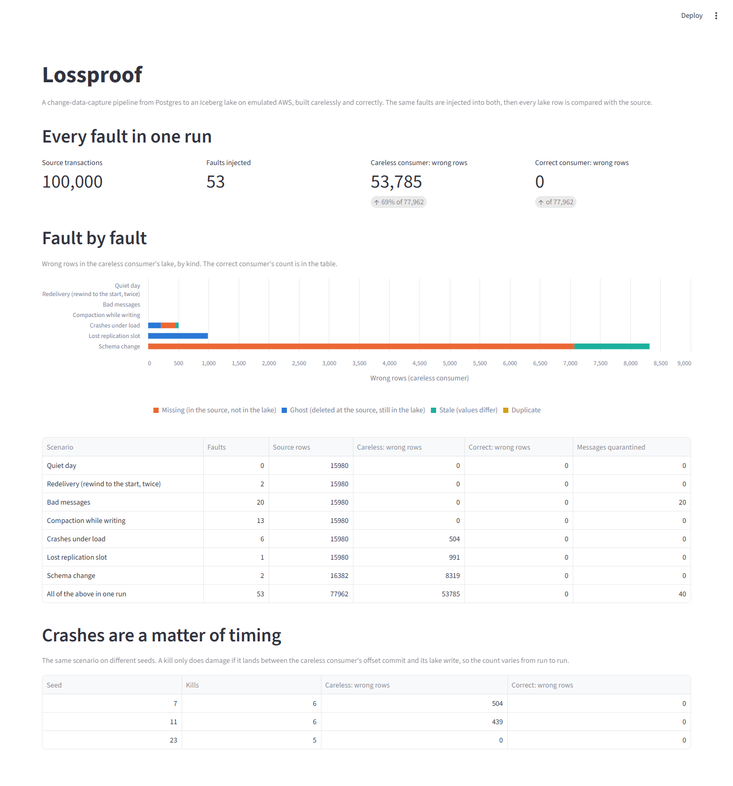

# Lossproof

A change-data-capture lakehouse on emulated AWS that proves it lost nothing.

A CDC pipeline usually looks correct on a quiet day. This project builds one from Postgres to an
Iceberg lake twice, once carelessly and once correctly, injects the same faults into both, and
compares every lake row with the source.



## Results

All numbers come from the commands below and are stored in [`results/chaos/`](results/chaos).
"Wrong rows" counts lake rows that are missing, stale, duplicated, or still present after being
deleted at the source.

### Every fault in one run

100,000 source transactions (about 320,000 messages on the topics) with a schema change, 28
consumer crashes, a lost replication slot, 20 bad messages and compaction running alongside.

| Consumer | Wrong rows | Of source rows |
|---|---|---|
| Careless | 53,785 | 77,962 (69%) |
| Correct | 0 | 77,962 |

The careless consumer's 53,785 are 42,629 missing rows, 8,502 stale rows and 2,654 ghost rows.

### Fault by fault

20,000 transactions each, seed 7. Both consumers read the same stream and are killed at the same
moments.

| Scenario | Faults | Careless: wrong rows | Correct: wrong rows |
|---|---|---|---|
| Quiet day | 0 | 0 of 15,980 | 0 |
| Redelivery (rewind to the start of every topic, twice) | 2 | 0 of 15,980 | 0 |
| Bad messages | 20 | 0 of 15,980 | 0 |
| Compaction while writing | 13 runs | 0 of 15,980 | 0 |
| Crashes under load | 6 kills | 504 of 15,980 | 0 |
| Lost replication slot | 1 | 991 of 15,980 | 0 |
| Schema change (one column added, one widened) | 2 | 8,319 of 16,382 | 0 |

- **Redelivery does no harm.** Replaying a contiguous stretch of changes in order ends in the same
  state, so even the careless consumer survives it.
- **A crash only hurts if it lands in a gap.** The careless consumer commits offsets on a timer
  and writes each batch as two commits. On three seeds it ended with 504, 439 and 0 wrong rows.
  The correct consumer ended with 0 on all three.
- **A lost slot loses deletes.** The new connector snapshots the rows that exist now. The 991 are
  rows deleted while nothing was listening, which no later message ever mentions.
- **A schema change is the most expensive.** The careless consumer drops the new column
  (1,246 stale customers) and fails to write quantities that no longer fit 32 bits, after it has
  already deleted the old versions of those rows (7,073 missing order lines).
- **Bad messages** are skipped by the careless consumer and sent to an SQS dead-letter queue by
  the correct one. Neither diverges, because junk is not a change.

### The nightly workflow

After 10,000 transactions on the main stream, one Step Functions execution:

| Step | Result |
|---|---|
| Maintain (Lambda) | Each table compacted from 15 data files to 1 |
| Reconcile (Lambda) | 0 wrong rows of 8,229; report written to S3, count published to CloudWatch |
| Marts (Lambda, dbt) | 7 models built, 10 tests passed |

The workflow ends in a `LakeDiverged` failure, before building any marts, if reconciliation finds
a single wrong row. The customer dimension holds 2,003 versions of 984 customers and is queryable
through Athena.

## How it works

```
generator ──> RDS Postgres ──WAL──> Debezium ──> MSK ──> consumer ──> Iceberg tables on S3
 (seeded)                                         │         │              │
                                            chaos harness   └─> SQS    Glue catalogue ──> Athena
                                                             (bad messages)

EventBridge Scheduler ──> Step Functions: maintain ──> reconcile ──> marts (dbt: SCD2 + facts)
                                          └───────────── one Lambda image ─────────────┘
```

Everything in AWS shape is created by Terraform against [Floci](https://floci.io), a free local
AWS emulator: S3, RDS, MSK, Glue, Athena, Lambda, Step Functions, EventBridge Scheduler, SQS,
Secrets Manager, CloudWatch, ECR and IAM roles.

### The careless consumer ([`consume/naive.py`](src/lossproof/consume/naive.py))

1. Offsets are committed by the Kafka client on a timer.
2. Changes are applied in arrival order.
3. A batch is two commits: delete the touched keys, then append.
4. The lake schema is fixed.
5. Errors are logged and the loop carries on.

### The correct consumer ([`consume/correct.py`](src/lossproof/consume/correct.py))

1. **Offsets live in the lake**, written in the same Iceberg commit as the rows
   ([ADR 002](docs/adr/002-offsets-in-the-lake.md)).
2. **Changes are merged by key and Postgres log position.** Deletes are kept as tombstones
   ([ADR 003](docs/adr/003-merge-by-log-position.md)).
3. **A batch is one commit per table.**
4. **New columns are added to the lake table.** Integers are always 64-bit.
5. **Bad messages go to a dead-letter queue** with their topic, partition and offset.
6. **When a new snapshot ends, rows it did not refresh are tombstoned.**
7. **If the maintenance task commits first, the batch is applied again** to the table as it now
   is ([ADR 004](docs/adr/004-two-writers.md)).

### The measurement ([`reconcile.py`](src/lossproof/reconcile.py))

Once the stream has drained, every source row and every lake row is reduced to a canonical string
and compared by primary key. The source's current columns decide what is compared, so a column the
lake never learned about counts as a difference.

The narrative is in [`STORY.md`](STORY.md). What the emulator could and could not do is in
[ADR 001](docs/adr/001-floci-spike.md).

## Run it

Needs [uv](https://docs.astral.sh/uv/), Docker, Terraform and a bash shell (Git Bash on Windows).
Docker needs about 3 GB of memory.

```bash
uv sync
bash scripts/up.sh                                   # Floci, Terraform, Debezium, consumer (about 4 minutes)

docker compose run --rm app source generate --n 10000
uv run python scripts/run_workflow.py                # compact, reconcile, build and test the marts
uv run python scripts/athena.py "select tier, count(*) from dim_customers where is_current group by tier"

uv run lossproof chaos crash                         # one scenario, both consumers
uv run lossproof chaos all                           # all of them (about 25 minutes)
uv run lossproof chaos everything --n 100000         # the headline run (about 10 minutes)

uv run streamlit run ui/app.py                       # dashboard (reads results/, needs nothing else)
bash scripts/down.sh                                 # stop and delete everything
```

A chaos scenario takes over the platform. Run `bash scripts/up.sh` again afterwards to get the
main stream back.

Tests, lint and types need neither Docker nor the emulator:

```bash
uv run pytest && uv run ruff check . && uv run mypy src
```

## Limits

- **It runs on an emulator.** The Terraform uses the standard AWS provider but has never been
  applied to real AWS. Floci's Athena is DuckDB and its MSK is Redpanda, so nothing here says
  anything about performance or cost on AWS. No IAM policies are written or tested.
- **Two workarounds for the emulator.** It accepts the RDS logical-replication parameter without
  applying it, so the bring-up script sets `wal_level` directly. Debezium connects to the Postgres
  container, because the emulated RDS endpoint does not pass the replication protocol.
- **Crash results depend on timing.** The schedule is seeded but a kill lands wherever the
  consumer happens to be. The correct consumer's zero comes from three seeds and the combined run. It is evidence, not a proof.
- **The combined run is one run** on one seed.
- **Reconciliation needs a quiet source.** It compares current states, so it runs after the
  stream has drained. A live system would compare at a log position.
- **Synthetic workload at laptop scale**, four tables, one consumer process, three partitions
  per topic. Compaction rewrites a whole table in memory.
- **The dead-letter queue is at-least-once.** A crash can quarantine the same bad message twice.
- **Tombstones and the customer history are never trimmed.**
- **Only two schema changes are handled:** an added column and a widened integer. Any other
  change stops the correct consumer, which is safe but needs a person.
